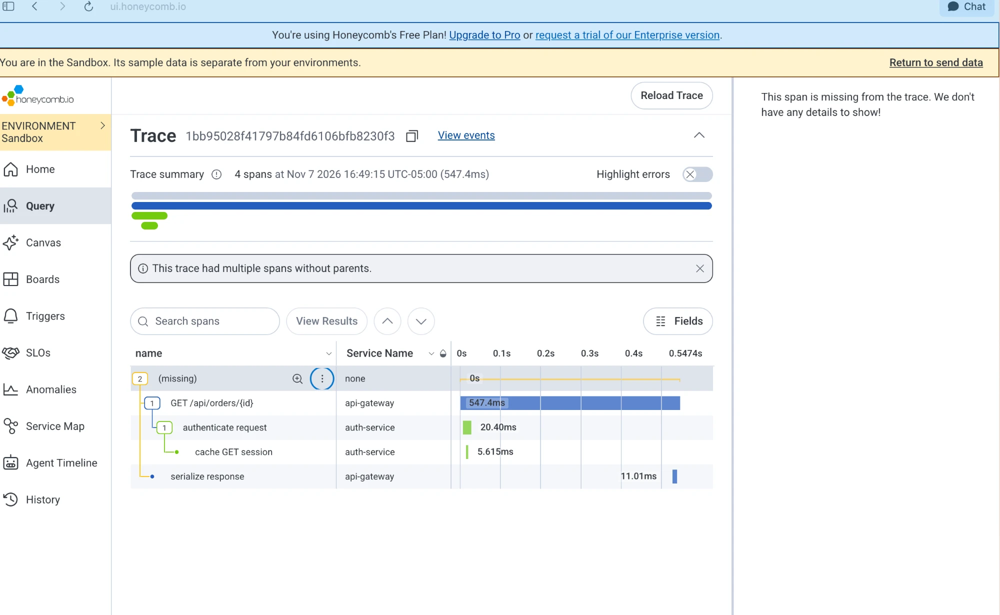
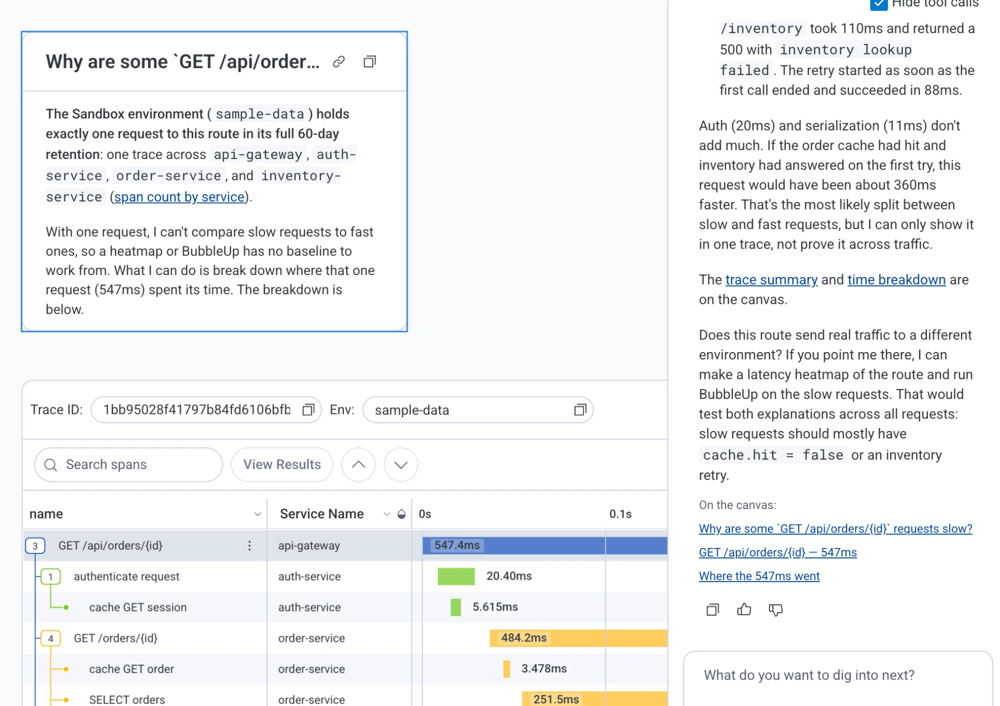
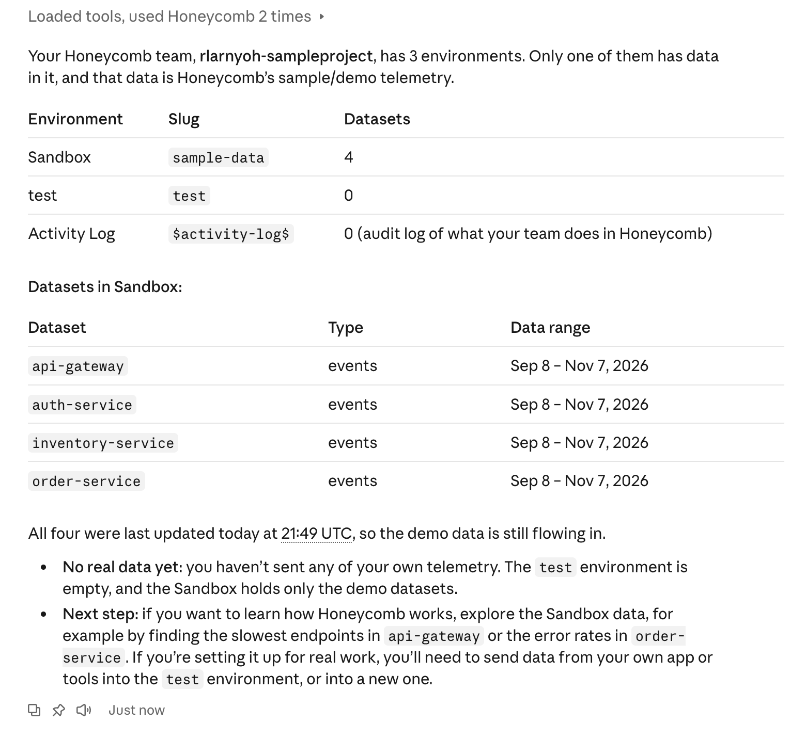

# Honeycomb MCP: A Product Marketing Sample

How I'd position, launch and enable sales for Honeycomb's MCP server, written after connecting it to Claude myself on Honeycomb's free plan.

**Robert Larnyoh** · [robertlarnyoh.com](https://www.robertlarnyoh.com) · November 2026
📄 [One-page PDF version](Robert_Larnyoh_Honeycomb_MCP_Sample.pdf)

> This is an independent work sample. I'm not affiliated with Honeycomb. Everything in "What I found" comes from my own test on Honeycomb's sandbox sample data.

---

## 1. The two-minute version

Web copy for an engineer who has never heard of it.

> ### Ask about production where you write code.
> Honeycomb's MCP server connects your AI coding assistant to your Honeycomb data, so you can investigate a slow endpoint or a bad deploy without leaving Claude, Cursor or VS Code.
>
> - **Ask in plain language.** Your assistant finds the right data, runs the queries and brings back the answer.
> - **Find what's different.** Across your real traffic, run BubbleUp and heatmaps from the chat to see what sets slow requests apart.
> - **See the reasoning.** It shows which Honeycomb tools it used, and says when there isn't enough data to be sure.
> - **Set up in minutes.** It's hosted, so there's nothing to run, and it works on the free plan.
>
> **Connect Honeycomb to your AI assistant →**

## 2. What I found testing it

Free plan, sandbox sample data, about 5 minutes to connect to Claude. I asked Canvas, then Claude through the MCP server, why one 547 ms `GET /api/orders/{id}` request was slow.

- **Same answer, two ways.** Both traced it to a 251 ms database query (46%) and an inventory call that failed after 110 ms and retried in 88 ms.
- **MCP went further.** Claude found 63 ms of gaps between steps, and two calls running one after another that might run in parallel to save about 100 ms.
- **It knew what it couldn't prove.** It confirmed the cache miss only after checking `cache.hit`, warned that the auth service records its own `cache.hit` (so a careless query would mix two caches), and flagged a filter that didn't work as expected.
- **Where I got stuck.** The sandbox has one request to this route, so BubbleUp, the signature feature, has nothing to compare against.
- **Messaging takeaway.** Lead with "it shows its work," not "AI finds the answer." And give the sandbox enough traffic to show BubbleUp.

| The trace I started with | Canvas's breakdown | The MCP server in Claude |
| --- | --- | --- |
|  |  |  |

## 3. Message

**Core message:** Your AI assistant can already read your code. With Honeycomb's MCP server, it can also see how that code behaves in production.

**Audience:** Engineers who already use an AI coding assistant, and the platform and reliability teams who support them.

| Pillar | What we say | Proof |
| --- | --- | --- |
| In your workflow | Investigate from your editor or Claude, without switching tools. | Hosted server, connected in about 5 minutes. |
| Real analysis | The tools an engineer uses: BubbleUp, heatmaps, traces. | The server offers BubbleUp, queries and traces. |
| Honest answers | It shows its work and says what it can't prove. | Confirmed the cache miss only after checking the data. |

## 4. Field note for sales engineers

**Ask:** "When production breaks, where do your engineers start, and how many tools do they open?" and "Which AI coding assistants does your team use today?"

| They say | We answer |
| --- | --- |
| "What can the agent see?" | Walk through the connector's sign-in and permissions using Honeycomb's security docs. Never guess on security. |
| "Our engineers don't use AI tools yet." | Start with Canvas inside Honeycomb, with no setup. The MCP server is ready when they are. |
| "Our current tool already has AI." | Don't compare what we can't prove. Answer one of their real questions with BubbleUp on their own data. |

## 5. Launch plan for a small release

| When | What | Done when |
| --- | --- | --- |
| 2 weeks before | Confirm scope and plan eligibility; write the message and FAQ | An engineer has checked it for accuracy |
| 1 week before | Update the setup guide; brief Sales Engineering with the field note | Someone new has set it up from the guide |
| Launch day | Blog post, changelog, customer email, in-app note | Published and linked to the setup guide |
| 2 weeks after | Results and lessons, including what didn't work | Shared with Product, Marketing and Sales |

**Measures:** teams connected in 30 days, weekly active MCP users, share of investigations started outside the Honeycomb UI, and what 5 customers say in follow-up calls.

---

*Background on Honeycomb Intelligence (the MCP server, Canvas and anomaly detection) from public coverage: [SD Times](https://sdtimes.com/observability/honeycomb-launches-ai-observability-suite-for-developers/), [APMdigest](https://www.apmdigest.com/honeycomb-intelligence-released).*
